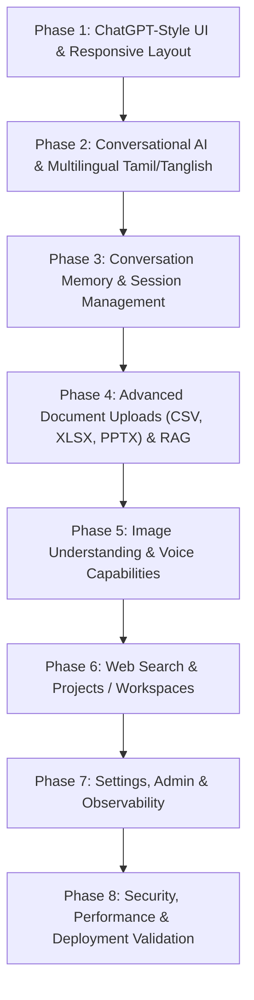

# Master Architecture & Implementation Plan: ChatGPT-Style Enterprise AI Platform

**Project:** AI Knowledge Assistant  
**Author / Lead:** AI System Architect  
**Date:** November 7, 2026  
**Status:** Codebase Audit Complete — Awaiting Approval for Phase 1 Execution  
**Target Design Reference:** ChatGPT Home & Chat Interface (`media_1794023783050_ca794b61.jpg`) and Feature Blueprint (`media_1794023810154_a893dd38.png`)

---

## 1. Executive Codebase Audit

### 1.1 Current Architecture & Technology Stack Status
The existing repository is a production-grade full-stack Python application with high test coverage (76/76 passing tests). All architectural foundations remain strictly preserved:

| Component | Technology | Current Implementation Status | Evaluation & Fit for Target Platform |
| :--- | :--- | :--- | :--- |
| **Frontend** | Streamlit (v1.44+) | Dual-mode ChatGPT UI with custom CSS, left sidebar, and capsule composer | Responsive, supports custom HTML/CSS, components, session state, and native file attachments. |
| **Backend API** | FastAPI (Python 3.12) | REST API on port 8000 with CORS, Pydantic v2 validation, and dependency injection | High throughput, asynchronous, clean separation of concerns (`api/`, `services/`, `core/`, `rag/`). |
| **Relational DB** | SQLite (`data/app.db`) | SQLAlchemy ORM with Users, Documents, Conversations, and ChatMessages | ACID-compliant, persistent across restarts, indexed foreign keys with cascade deletions. |
| **Vector DB** | ChromaDB (`chroma_data/`) | Persistent vector store with metadata filtering (`user_id`, `document_id`) | Local, no cloud dependency, persistent vector embeddings with cosine similarity. |
| **Embeddings** | Sentence Transformers (`all-MiniLM-L6-v2`) | Local 384-dimensional dense vectors cached in `.cache/` | Zero external API latency, CPU/GPU accelerated, robust multilingual semantic support. |
| **LLM Engine** | OpenAI API client (`gpt-4o-mini`) | `backend/app/rag/pipeline.py` with fallback for unconfigured API keys | Currently single-turn RAG only; lacks conversational memory and multilingual Tanglish/Tamil system prompting. |
| **Authentication**| JWT (HS256) | `python-jose` with bcrypt password hashing and Bearer tokens | Secure token verification with user isolation in all service layers. |
| **Ingestion** | PyMuPDF (`fitz`), `python-docx`, Python text | PDF, DOCX, TXT loaders with page-level preservation and normalization | Robust for PDF/DOCX/TXT; requires extension for CSV, XLSX, and PPTX. |

---

### 1.2 Module-by-Module Gap Analysis

```
Existing Implementation                           Target ChatGPT-like Platform
┌────────────────────────────────────────┐       ┌────────────────────────────────────────┐
│ - Heading: "Ready when you are"       │       │ - Heading: "What are you working on?"  │
│ - Composer: [ + ] [ Ask question ] [↑] │       │ - Composer: [ + ] [ Ask anything ] [🎙][ıllı]
│ - Single-turn RAG only (Doc QA)        │  ==>  │ - Dual Mode: General Chat + RAG QA     │
│ - English-only strict prompt           │       │ - Multilingual: Tamil, Tanglish, Eng   │
│ - PDF, DOCX, TXT ingestion only        │       │ - PDF, DOCX, TXT, CSV, XLSX, PPTX      │
│ - No conversation memory in prompt     │       │ - Multi-turn memory & context window   │
│ - No Web Search mode                   │       │ - Toggleable Web Search with citations │
│ - Document Collections list only       │       │ - User-defined Projects & Workspaces   │
│ - Static response generation           │       │ - Streaming token generation           │
└────────────────────────────────────────┘       └────────────────────────────────────────┘
```

#### Gap 1: UI/UX Alignment with Reference Screenshot (`media_1794023783050_ca794b61.jpg`)
* **Header & Workspace:** The latest ChatGPT reference displays `"What are you working on?"` rather than `"Ready when you are."`.
* **Sidebar Layout:** Left sidebar needs `📝 New chat`, `🔍 Search chats` (real-time filter), `🖼 Images`, `⠿ Apps`, `Projects` section with `➕ New project`, and collapsible `Your chats ⌄` with pin (`📌`) and context options (`•••`). Bottom displays user profile avatar, plan badge ("Free"), and "Upgrade" button.
* **Top Navigation:** Top bar should display `ChatGPT ⌄` (model selector pill), `◆ Upgrade to Go` pill badge, and user icons on the top right.
* **Input Capsule:** Input pill needs attachment `+` on left, placeholder `"Ask anything"`, mic `🎙` for voice input, and waveform `ıllı` on right.

#### Gap 2: Dual Conversational AI Mode & Multilingual Engine (Tamil, Tanglish, English)
* **Current Limitation:** If a user asks general questions (`"Hi"`, `"What is machine learning?"`, `"Machine learning na enna?"`), the pipeline looks for documents and returns: *"I cannot find the answer to this question in the uploaded documents."*
* **Target Behavior:** The assistant must intelligently detect whether the user is asking a general conversation question or a document-specific query. When documents are attached or selected, it grounds its response strictly in the document context; when none are selected or general queries are posed, it operates as a full-featured conversational assistant.
* **Language Detection & Response:**
  * Auto-detect Tamil script (`[\u0B80-\u0BD7]`), Tanglish (phonetic Tamil in Latin script, e.g., *"epdi irukinga"*, *"na enna"*), and English.
  * System prompt configured with explicit Tanglish/Tamil few-shot instructions: respond in the user's language, explain technical concepts clearly in natural Tamil, and maintain technical keywords in English.
  * Persist detected/chosen language across conversation turns.

#### Gap 3: Conversation Memory & Context Window
* **Current Limitation:** Conversations are saved in SQLite, but `rag_pipeline.answer_question()` only accepts `question: str`. Prior messages in the conversation are not passed to the LLM.
* **Target Behavior:** Inject the last $N$ turns (user/assistant history) into the prompt context so the AI remembers follow-up questions (`"Tell me more about the second point"`, `"Translate that to Tamil"`).

#### Gap 4: Document Formats & Ingestion Pipeline
* **Current Limitation:** Only `.pdf`, `.docx`, `.txt` are accepted.
* **Target Behavior:** Safely add `.csv` (structured tabular preview), `.xlsx` (openpyxl sheet extraction), and `.pptx` (python-pptx slide text) extractors with security scanning and chunking.

#### Gap 5: Voice & Multimodal Features
* **Current Limitation:** Text only.
* **Target Behavior:**
  * Browser-native Speech-to-Text (Web Speech API) with Tamil (`ta-IN`) and English (`en-US`) support.
  * Browser-native Text-to-Speech (Web Speech API) with playback controls.
  * Image attachment preview and vision API integration (using OpenAI vision `gpt-4o-mini` with graceful fallback when unconfigured).

#### Gap 6: Web Search & Projects
* **Current Limitation:** No web search; documents are listed loosely without project workspaces.
* **Target Behavior:**
  * Web Search mode toggle: Search queries via DuckDuckGo / Tavily with external web domain citations.
  * Projects table in SQLite: Create, rename, delete workspaces and associate documents and chats.

---

## 2. Master 8-Phase Implementation Roadmap



---

### Phase 1: ChatGPT-Style UI and Responsive Layout
* **Objective:** Reproduce the exact visual structure, layout, typography, and controls from `media_1794023783050_ca794b61.jpg`.
* **Frontend Changes:**
  * Update `frontend/components/sidebar.py`:
    * Top branding with ChatGPT logo and collapse trigger (`◨`).
    * Pill button `📝 New chat`.
    * Search chats quick-filter input (`🔍 Search chats`).
    * Quick links: `🖼 Images (NEW)` and `⠿ Apps`.
    * Collapsible `Projects` section with `➕ New project` modal trigger.
    * Collapsible `Your chats ⌄` with pinned status (`📌`), active item highlighting, and menu triggers (`•••`).
    * User profile card at bottom with initials avatar circle, name, "Free" plan label, and "Upgrade" button.
  * Update `frontend/components/header.py`:
    * "ChatGPT ⌄" model dropdown (`gpt-4o-mini`, `gpt-4o`).
    * Pill badge `◆ Upgrade to Go`.
    * User action icons on right.
  * Update `frontend/components/chat_ui.py`:
    * Center greeting header: **"What are you working on?"**
    * Centered capsule composer:
      `[ + ]  [ Ask anything ]             [ 🎙 ] [ ıllı ]`
    * Inline attachment button on left, placeholder `"Ask anything"`, mic and audio mode triggers on right.
    * Conversation thread: User right-aligned bubble (`#F4F4F4`), assistant left-aligned response with brain avatar, copy answer (`📋`), regenerate (`🔄`), edit prompt, and expandable citations.
  * Update `frontend/styles/custom.css`:
    * Exact color palette, hover states, capsule borders (`#E5E5E5`), and responsive flexbox alignment.
* **Verification & Tests:**
  * Component rendering tests in `test_frontend_integration.py`.
  * Regression test across all existing 76 tests.

---

### Phase 2: Real AI Generation and Multilingual Tamil/English Support
* **Objective:** Enable natural multilingual conversations (Tamil, English, Tanglish) with auto-detection and dual conversational/RAG routing.
* **Backend Changes:**
  * Create `backend/app/services/language_service.py`:
    * Tamil script regex detection: `[\u0B80-\u0BD7]`.
    * Tanglish phonetics vocabulary dictionary and heuristic regexes (e.g., words like *enna, epdi, sollunga, pannu, irukku, theriyuma, nalla, romba, ethu, yaaru*).
    * Language enum: `TAMIL`, `TANGLISH`, `ENGLISH`, `AUTO`.
  * Update `backend/app/rag/prompts.py`:
    * Multilingual System Prompt with instructions for Tamil, Tanglish, and English.
    * Few-shot examples of natural technical explanations in Tamil preserving English keywords.
  * Update `backend/app/rag/pipeline.py` & `backend/app/services/chat_service.py`:
    * Dual-mode routing: If documents are selected or document search finds relevant chunks, apply strict Grounded RAG. If no documents are attached and the user asks general or conversational queries, invoke General Conversational AI mode.
    * Pass detected language to prompt and maintain language consistency in follow-up turns.
* **Verification & Tests:**
  * `test_multilingual_ai.py`:
    1. Tamil query → Tamil output.
    2. Tanglish query (`"Machine learning na enna?"`) → Tamil/Tanglish explanation with English technical terms.
    3. English query → English output.
    4. General query without documents answers naturally without returning "cannot find in documents".

---

### Phase 3: Conversation Memory, Chat History and Management
* **Objective:** Enable multi-turn conversational context, conversation search, renaming, and automatic title generation.
* **Backend Changes:**
  * Update `backend/app/schemas/chat.py`: Add `ConversationRenameRequest`, `ConversationSearchRequest`.
  * Update `backend/app/api/chat.py`:
    * `PATCH /api/chat/history/{id}` for renaming conversations.
    * `GET /api/chat/search?q=...` for searching through conversation titles and message contents.
  * Update `backend/app/services/chat_service.py`:
    * Auto-title generation after the first turn using LLM or smart summarization heuristic.
    * Multi-turn memory: load previous $N$ messages (configurable, default 6) and pass as message history to `chat.completions.create`.
* **Frontend Changes:**
  * Sidebar search bar filtering past chats in real time.
  * Edit conversation title directly in the UI.
  * Retain conversation state across browser refreshes.
* **Verification & Tests:**
  * `test_conversation_memory.py`: Context retention across 3 consecutive turns; rename/search/delete operations.

---

### Phase 4: Advanced Document Uploads and Improved RAG
* **Objective:** Extend document parsing to CSV, XLSX, PPTX; support multi-document selection and chunk preview.
* **Backend Changes:**
  * Update `backend/app/rag/document_loader.py`:
    * Add `csv` loader (structured table summary + row chunks).
    * Add `xlsx` loader (`openpyxl` sheet tables).
    * Add `pptx` loader (`python-pptx` slide titles, notes, and shape text).
    * Validation: file extension, MIME type, size limit ($\le 15\text{ MB}$), and anti-tampering checks.
  * Update `backend/app/rag/retriever.py`:
    * Hybrid retrieval support combining dense vector similarity with keyword/metadata boosting.
* **Frontend Changes:**
  * Composer upload icon accepts `.pdf`, `.docx`, `.txt`, `.csv`, `.xlsx`, `.pptx`.
  * Upload status indicator with real-time chunking feedback.
* **Verification & Tests:**
  * `test_document_loaders_extended.py`: Ingest sample CSV, XLSX, PPTX, verify chunking, embeddings in ChromaDB, and question answering.

---

### Phase 5: Image Understanding and Voice Capabilities
* **Objective:** Add vision file attachments and browser-native voice input (STT) & audio output (TTS).
* **Backend & Frontend Implementation:**
  * Vision:
    * Composer file attachment accepts `.png`, `.jpg`, `.jpeg`.
    * If OpenAI vision model is available (`gpt-4o-mini`), format image as base64 and send to OpenAI vision API.
    * Graceful fallback if vision model is unavailable.
  * Voice Features:
    * Browser-native Web Speech API component:
      - Speech-to-Text (STT) with Tamil (`ta-IN`) and English (`en-US`) recognition directly into the composer.
      - Text-to-Speech (TTS) reading out assistant responses with play/stop toggle.
* **Verification & Tests:**
  * `test_vision_and_audio.py`: Validate image attachment validation, base64 payload formatting, and fallback handling.

---

### Phase 6: Web Search and Projects / Workspaces
* **Objective:** Separate public web search mode and project organization.
* **Backend Changes:**
  * SQLite schema migration: Create `projects` table:
    * `id`, `user_id`, `name`, `description`, `created_at`, `updated_at`.
    * `project_documents` link table (associating documents with projects).
    * `project_id` foreign key on `conversations`.
  * API endpoints:
    * `POST /api/projects`, `GET /api/projects`, `DELETE /api/projects/{id}`.
    * `POST /api/projects/{id}/documents`.
  * Web Search Service:
    * DuckDuckGo / Tavily search integration with source links and publication dates.
    * Distinguish web source links from uploaded document citations.
* **Frontend Changes:**
  * Left sidebar: `Projects` section with `➕ New project` modal.
  * Composer: Web search toggle pill.
* **Verification & Tests:**
  * `test_projects_and_web_search.py`: User isolation in projects, document association, web search result structuring.

---

### Phase 7: Settings, Admin and Observability
* **Objective:** Enhanced user preferences, model selector, administrative observability, and telemetry.
* **Features:**
  * Settings page:
    * Language preference: Automatic (Default), English, Tamil.
    * Model configuration: Select active model (`gpt-4o-mini`, `gpt-4o`).
    * Response style: Balanced, Precise, Creative.
    * Chat history & memory retention controls.
    * Masked API key status indicators.
  * Admin Panel:
    * System telemetry, document storage metrics, active conversations, ChromaDB collection status, and error logs.
* **Verification & Tests:**
  * `test_settings_and_admin.py`: Verify preference persistence, role-based access control for admin endpoints.

---

### Phase 8: Security, Performance and Deployment Validation
* **Objective:** Final security hardening, performance verification, and Docker validation.
* **Verification Checklist:**
  * Path traversal protection, file validation, and SQL injection defense.
  * Cross-user data isolation across users A and B.
  * Persistence across container and server restarts (SQLite + ChromaDB).
  * Full regression test run across all test suites.
  * Final production readiness sign-off.

---

## 3. Strict Quality Gates & Governance

1. **No Migration:** The core stack (Streamlit + FastAPI + SQLite + ChromaDB + SentenceTransformers + JWT) remains strictly unchanged.
2. **Incremental Delivery:** Each phase will be executed step-by-step with automated tests, documentation updates, and regression verification.
3. **No Fabricated Data:** Citations, test results, and connection statuses will always reflect genuine execution.
4. **Approval Gate:** As instructed, Phase 1 execution will commence only after the user's explicit confirmation.
